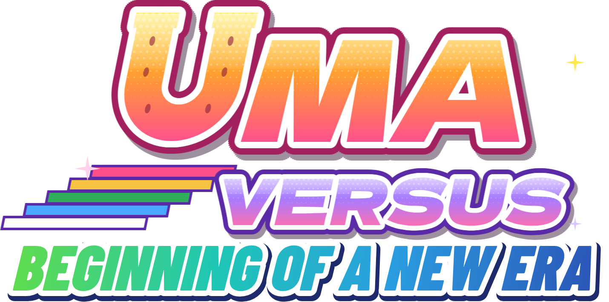

# Uma Versus

A fan-made 2D fighting game with the Umamusume cast. It runs in the browser, no install needed.

**Update 2.0.1 · build `9e9133`**

- 12 characters, each with her own play style, and palettes for every one
- Arcade mode with rivals, a final boss and endings, plus a tutorial
- Local versus, VS CPU with four difficulty levels, a training mode with frame data and hitboxes, combo trials and replays
- Online play with rollback netcode, room codes, a public room list and spectating
- Friends, invites and leaderboards
- 4 stages, and a theme for every character
- Optional accounts for your online name, cloud saves and match history

## Stuff

Default controls (you can change them all under *Controls*):

| | Player 1 | Player 2 | Gamepad |
|---|---|---|---|
| Move | W A S D | Arrow keys | D-pad / stick |
| Light / Medium / Heavy | F / G / H | J / K / L | X / Y / B |
| Skill | T | I | A |
| Throw (L+M) / Super (S+H) | R / Y | U / O | LB / RB |
| Dash | set under *Controls* | | |

The wiki has the full guide, frame data for every move and all the combos: https://umaversus.lol/wiki/

## Community

- Discord: https://discord.gg/gUgfWuWhQh
- YouTube: https://www.youtube.com/@UmaVersus
- TikTok: https://www.tiktok.com/@uma.versus

## Credits

- Fan project. *Umamusume: Pretty Derby* and its characters belong to Cygames, Inc. This project is not affiliated with or endorsed by Cygames.
- The sprites belong to Cygames and I do not claim credit for the creation or the ownership of them (Unsure who extracted the sprites. Please let me know if you know!!). I obtained them at this link: <https://www.spriters-resource.com/pc_computer/umamusumeprettyderbypartydash/>
- The music also belongs to Cygames.
- Free and non-commercial.
- Fonts: Barlow Condensed and Dela Gothic One, SIL Open Font License 1.1 (see `vendor/fonts/`).
- Netcode: PeerJS, MIT License (see `vendor/`).
- Accounts: supabase-js, MIT License (see `vendor/`).

DISCLAIMER: Made with AI help on the code (see [AI-DECLARATION.md](AI-DECLARATION.md) for more details). The characters move sets are my own, and I've tested and tuned everything with the help of others.
