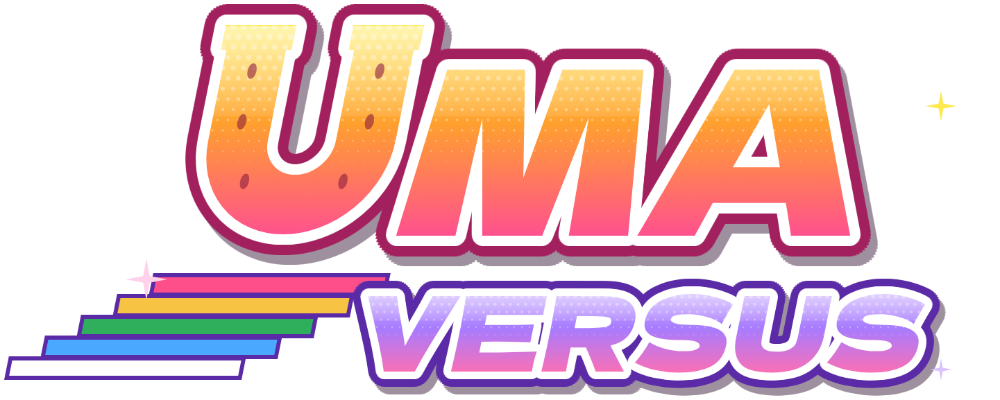

# Uma Versus

A fan-made 2D fighting game starring the Umamusume characters.

**Update 1.8 · build `a61915`**

- 8 unique characters
- Local versus, VS CPU (four levels), Training with frame data and hitboxes, Combo Trials with demos, replays
- Online play with rollback netcode and room codes (peer-to-peer through PeerJS)
- 4 stages and a soundtrack with a theme for every runner
- Optional accounts: your name online, cloud save of settings, and a match history

## Stuff

Default controls (all rebindable under *Controls*):

| | Player 1 | Player 2 | Gamepad |
|---|---|---|---|
| Move | W A S D | Arrow keys | D-pad / stick |
| Light / Medium / Heavy | F / G / H | J / K / L | X / Y / B |
| Skill | T | I | A |
| Throw (L+M) / Super (S+H) | R / Y | U / O | LB / RB |

The full guide to the systems, every move's frame data and every combo is in the wiki at https://uma-versus-wiki.wuaze.com

## Credits

- Fan project. *Umamusume: Pretty Derby* and its characters belong to Cygames, Inc. This project is not affiliated with or endorsed by Cygames.
- Free and non-commercial: no monetization of any kind.
- Fonts: Barlow Condensed and Dela Gothic One, SIL Open Font License 1.1 (see `vendor/fonts/`).
- Netcode transport: PeerJS, MIT License (see `vendor/`).
- Accounts: supabase-js, MIT License (see `vendor/`).
